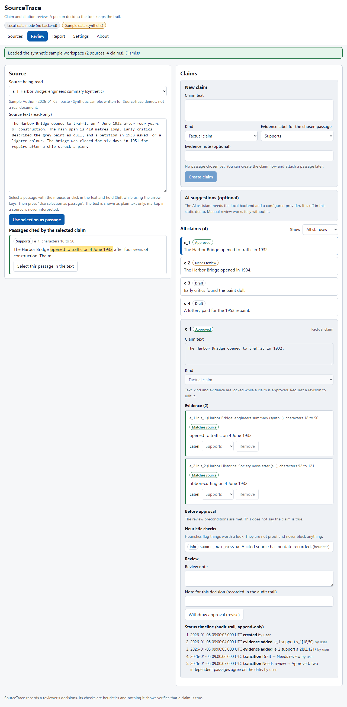

# SourceTrace

Claim and citation review. Import a source text, write a claim, attach the **exact passage** that
bears on it, label that passage as supporting, contradicting or unknown, and move the claim through a
review process that only a person can drive. Every change is kept in an append-only audit trail,
including approvals that were refused.



> **Status:** v0.1, built and independently tested locally. It is **not published or deployed**:
> there is no hosted demo yet, so run it locally (below).
> SourceTrace does **not** verify that anything is true. Its checks are heuristics, its approval gate
> only checks review preconditions, and an optional AI assistant can only suggest drafts.

## What it does

- **Sources**: paste text, load a Markdown or text file, or (with the local backend) extract text from a
  text PDF. Title, author, date, provenance, source URL (metadata only, never fetched) and a rights
  note are stored with a SHA-256 content hash. Identical text is de-duplicated.
- **Claims** of five kinds: factual claim, interpretation, disputed assertion, fictional canon
  assertion, creator inference.
- **Exact passages**: select text with the mouse **or the keyboard** (Shift and arrow keys), then
  "Use selection as passage". A locator stores code point offsets, the exact passage and a context
  hash, so a changed source can never silently re-point a citation.
- **Side-by-side review**: source text with highlighted cited passages on one side, claim, evidence,
  warnings and the status timeline on the other (stacked on narrow screens).
- **State machine**: draft, needs review, approved / rejected / revise. Only a user action moves a
  claim. Approval is refused with precise reasons when there is no matching supporting passage, or
  contradicting evidence is attached to a claim that is not a disputed assertion; the refused
  attempt is recorded.
- **Heuristic checks** (labelled as such): missing source, unsupported claim, mismatched citation,
  quoted text or dates that do not appear in the cited passage, duplicate claims, missing source date.
- **Export** a traceable evidence report as Markdown and JSON; back up and restore the whole
  workspace as validated JSON.
- **Optional local backend**: FastAPI + SQLite for saving validated snapshots, bounded PDF text
  extraction in an isolated process, and an opt-in AI suggestion broker (off unless configured).

## Quick start

Needs Node.js 20.19 or newer. The backend is optional and needs Python 3.11 or newer.

```powershell
npm ci
npm run dev                  # http://localhost:5174/source-trace/  (static, no backend)
```

Optional backend:

```powershell
python -m venv .venv
.\.venv\Scripts\python -m pip install -r backend\requirements.lock.txt
cd backend ; ..\.venv\Scripts\python -m source_trace    # http://127.0.0.1:8797
```

Then open Settings in the app and press "Use the backend". The static app never contacts a backend
until you do.

Run the whole gate (format, lint, types, unit tests, backend lint/format/types/tests, golden vectors,
differential fuzz, production build, secret scan, end-to-end tests):

```powershell
npm run verify               # or scripts\verify.ps1 / scripts/verify.sh
```

## Try it with the synthetic sample

Sources, "Load sample data". It loads two invented texts about a fictional bridge and four claims in
different states (one approved, one contradicted, one draft interpretation, one unsupported). A
"Sample data (synthetic)" chip is shown while it is loaded. Nothing in it is a real document.

## Safety and truthfulness

- Nothing in the UI, the exports or these docs says or implies that truth was verified.
- Source text is rendered as plain text only. Markup, scripts and prompt-injection-like text in a
  source are inert (tested).
- PDFs are untrusted: size and page caps, parsed in a separate isolated process with a time limit.
- The AI assistant is disabled by default, needs a server-side configuration **and** a per-session
  opt-in in the UI, returns schema-validated suggestions that may only cite passages that exist in the
  text you sent, and has no access to claims or statuses. Keys live only in the server environment.
- Use only public domain, licensed, synthetic or your own source texts. See
  [docs/known-limitations.md](docs/known-limitations.md).

## Project map

| Path                                   | What                                                          |
| -------------------------------------- | ------------------------------------------------------------- |
| `src/engine`                           | The domain engine (TypeScript): text, locators, state, checks |
| `backend/source_trace`                 | FastAPI app, store, PDF worker, AI broker, Python engine twin |
| `docs/spec`                            | The written specification (read first)                        |
| `contracts/vectors`, `contracts/tools` | Golden vectors, vector generator, differential fuzz           |
| `e2e`                                  | Playwright journeys (static build and real backends)          |

Details: [docs/architecture.md](docs/architecture.md), [docs/demo.md](docs/demo.md),
[docs/test-report.md](docs/test-report.md), [docs/handoff.md](docs/handoff.md),
[SECURITY.md](SECURITY.md), [AI_ASSISTANCE.md](AI_ASSISTANCE.md).

## License

MIT, see [LICENSE](LICENSE).
